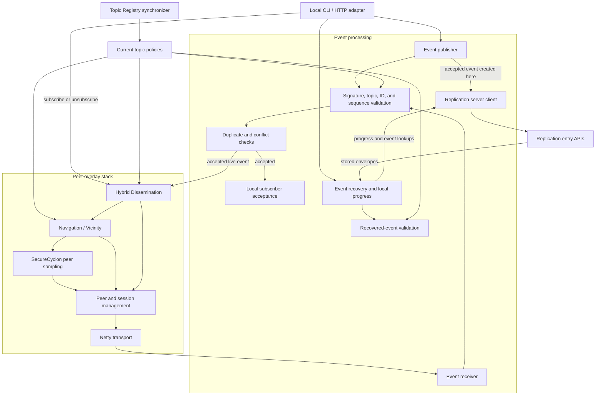

# D2 — Pub/Sub node internal architecture

A Pub/Sub node is one JVM that can act as publisher, subscriber, and forwarding
peer at the same time. This diagram separates its event-processing path from the
overlay stack that finds and communicates with peers.

## How to read D2

There are three event entry points. An event published through this node is
constructed and validated by the publisher path. An event published through
another node arrives through Netty and the receiver. A missed event returns
through the recovery path. All three are checked against the current topic
policy before local acceptance.

For a live accepted event, duplicate/sequence state prevents loops from causing
multiple deliveries. The dissemination layer chooses topic-relevant peers using
Navigation plus a small random component. Navigation gets candidate peers from
SecureCyclon, while session management and Netty provide the actual connections
and bytes on the wire.

Only the node that originated an accepted live event submits it for storage.
Other nodes validate, deliver, and forward it, but do not create another store
request. Recovery queries publisher progress, reconstructs missing event keys,
fetches stored envelopes, revalidates them, replays them in sequence order, and
advances the durable delivery cursor.

`EventProcessingService` calls `DisseminationService` to send accepted events to peers.
It calls `EventStorageService` to save the highest accepted sequence
locally for recovery and to queue events created by this node for storage on
replication servers. It does not own either service's lifecycle. The storage
and recovery service has no callback to `EventProcessingService`. The HTTP adapter
passes `eventService::validateRecoveredEvent` to `recover(...)` for each recovery
request, so recovered events return through validation without a circular
dependency.

`EventProcessingService` runs only when an event operation is invoked; it has no
background cycle. `DisseminationService` periodically refreshes topic forwarding
peers using Navigation candidates and sends gossip.
`EventStorageService` queues event storage on a worker and manages
recovery, but does not run a peer-message cycle. Acceptance-test forced
broadcasts also go through `DisseminationService`,
which bypasses topic-based peer selection for that send.

The acceptance replay route lives in `NodeControlHttpAdapter`, outside
`EventProcessingService`. It resends a supplied envelope through dissemination without
local validation or a storage request so duplicate handling can be checked.

## Important boundary

The Topic Registry synchronizer supplies cached topic rules to validation and
routing. It is not in the per-message network path: an event does not wait for a
Cardano query while being forwarded.

The network boundary is intentionally duplex. Netty reports inbound activity
through `TransportListener`, while node services send outbound messages through
the small `TransportSender` interface. `PubSubTransport` implements the sender,
but services do not depend on that concrete Netty class. The resulting listener/
sender object loop is accepted for this prototype because peer protocols must
both receive and send continuously; queues or a separate message bus would add
machinery without changing that two-way flow.
