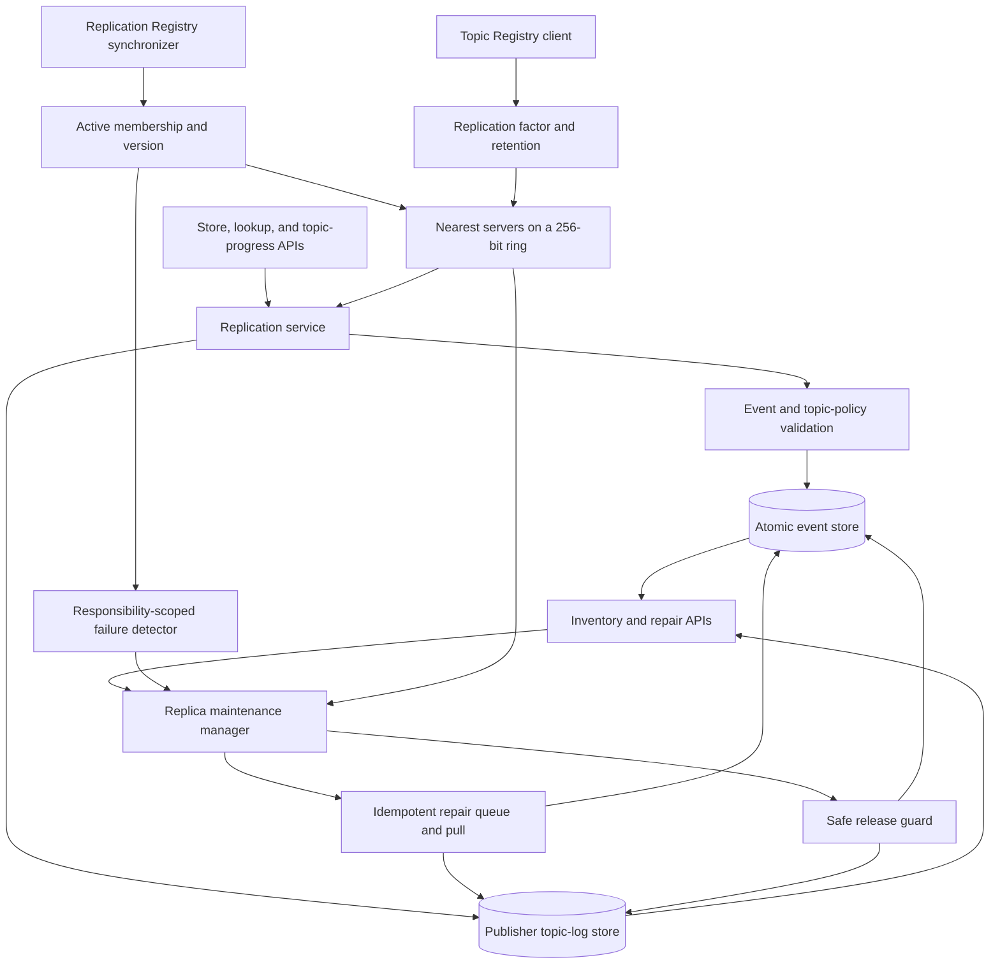

# D3 — Replication server internal architecture

Replication servers hold durable event copies and per-topic publisher progress.
Every server runs the same code; “entry,” “responsible,” and “surviving” describe
its role for a particular request or key, not different server types.

## How to read D3

A Pub/Sub node contacts any active server as an entry point. For a store request,
that server validates the event, hashes its event key, and selects the closest
`R` active server IDs on a 256-bit ring. It sends the event record to those
responsible servers. Publisher progress is stored separately in a topic log,
using the topic-log key and the topic's same replication factor.

The registry exposes `ReplicationServerState`, which contains a
`ReplicationServerEndpoint` plus operator, commitment, and active status. Active
membership selects the endpoint from each active registration for placement and
HTTP calls. Local server configuration can also create an endpoint without a
registry record, so the endpoint remains a separate shared type.

Lookup is also brokered by the entry server. It calculates candidate servers and
tries them in deterministic order, so the caller does not need to know which
server owns a key. The event store and topic-log store are logically distinct
because recovery first discovers the latest sequence for each publisher and
then fetches the corresponding event keys.

## Local file store

`FileEventStore` is the replication server's disk adapter. Each server creates
one instance at its configured storage root. It stores only that server's local
copies; `ReplicationService` chooses responsible servers and sends replica
writes, while `ReplicaMaintenanceService` inventories, repairs, and releases
copies. The Pub/Sub node's `EventStorageService` submits storage requests to
replication servers and manages subscriber recovery; it does not use this file
store directly.

| Path under the storage root | Contents |
| --- | --- |
| `events/<event-key>.json` | A `StoredEvent` with the envelope, storage time, and retention epochs. |
| `topic-logs/<topic-id>.json` | The latest signed `PublisherProgress` entry for each publisher in that topic. |
| `metadata/topic-index.json` | Topic IDs with local progress logs, used by replica maintenance. |
| `metadata/server-id.txt` | The server identity bound to this storage directory. |

`createEventRecord` sets the event key and original storage time and epoch.
`ReplicationService` checks that this server belongs to the current responsible
replica set before writing. Event keys are derived from topic ID, publisher key
ID, and sequence number. `storeEventReplica` checks the key and storage epoch,
then replaces the sender's retention period and expiry with values calculated
from the current topic state on the chain. Repeated replica writes keep the
record with the earlier storage time.

Each event read recalculates expiry from its original storage epoch and the
current topic retention period, updating the file when the period changes.
The cleanup scan uses the same rule. A shorter period can expire an event
immediately; a longer period extends an event that is still stored. If fresh
topic state is unavailable, the store leaves the file in place and the read
fails. Once an expired file has been deleted, a later period increase cannot
restore it. The raw event-key inventory can include expired files until they
are read or scanned. Progress updates advance only for a higher sequence, or
for a later timestamp at the same sequence.

The maintenance manager continuously observes membership, topic configuration,
peer health, and peer inventories. When placement changes or a relevant
peer is confirmed unavailable, a newly responsible server pulls records from a
surviving source. Operations are idempotent, so repeated repair notifications
are safe.

`ReplicaMaintenanceService` owns the scheduled maintenance and expiration
cleanup jobs. The application starts and closes the service; each maintenance
cycle runs the placement and repair workflow, while cleanup asks the local file
store to remove expired events.

## Safe release rule

Removal is deliberately conservative. A server deletes a now-obsolete local
copy only after every currently responsible target advertises an equivalent
record under the exact current membership fingerprint. A suspected failure or
stale inventory therefore causes extra copies to remain rather than risking
data loss.

The failure detector probes only peers relevant to records held locally. This
keeps detection responsibility distributed; there is no central repair leader.
