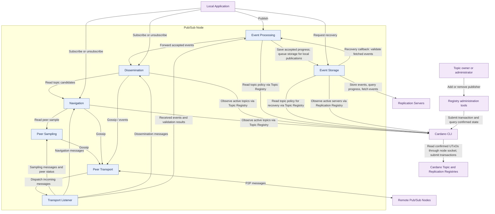

# Pub/Sub node architecture

Arrows show calls, callbacks, or registry dependencies. Responses are omitted.
Outgoing peer messages pass through Peer Transport; incoming messages return
through Transport Listener. Registry arrows to Cardano CLI summarize each
service's dependency; the services consume locally refreshed registry views.

