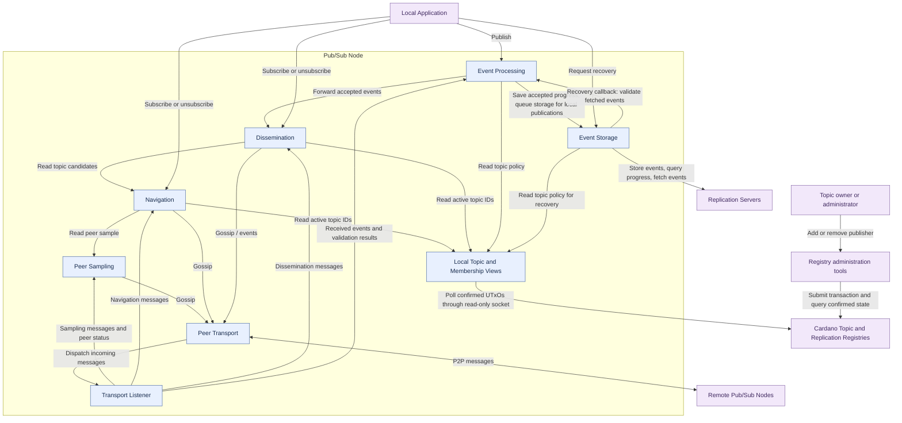

# Pub/Sub node architecture

Arrows show calls or callbacks. Responses are omitted. Outgoing peer messages
pass through Peer Transport; incoming messages return through Transport Listener.
Each node queries Cardano independently and publishes local registry views.

